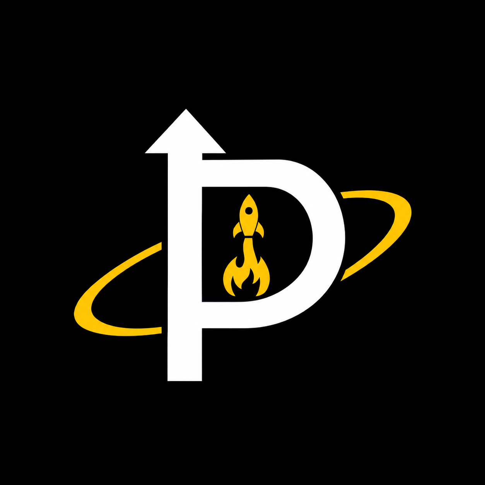
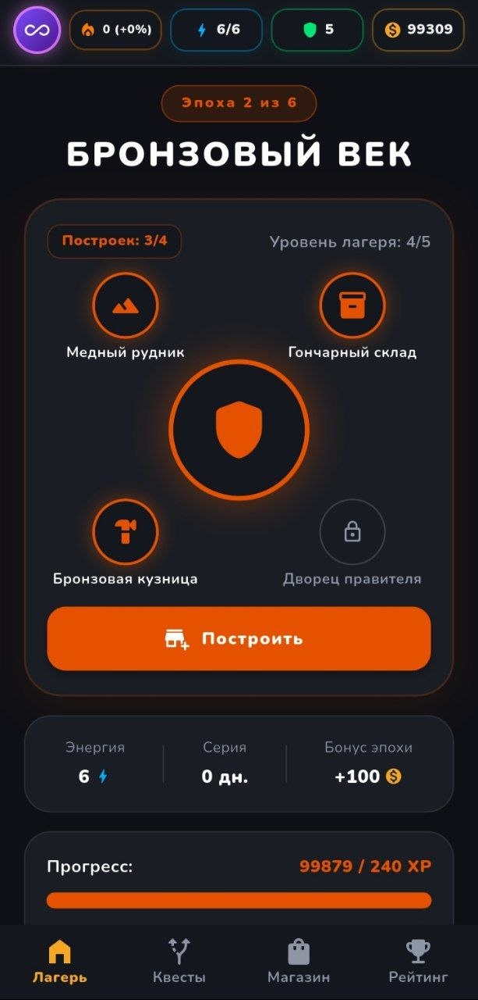
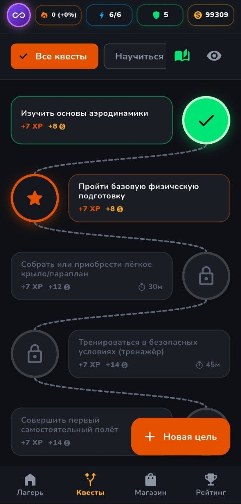
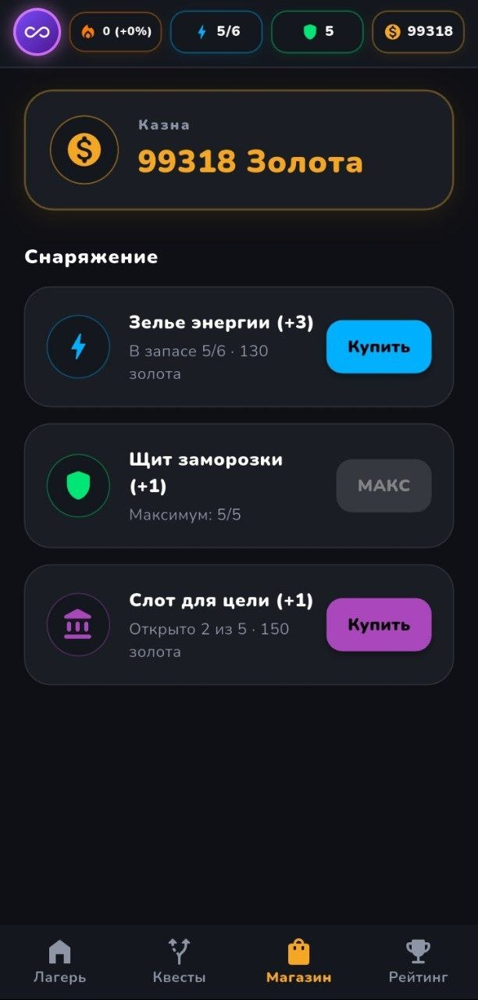
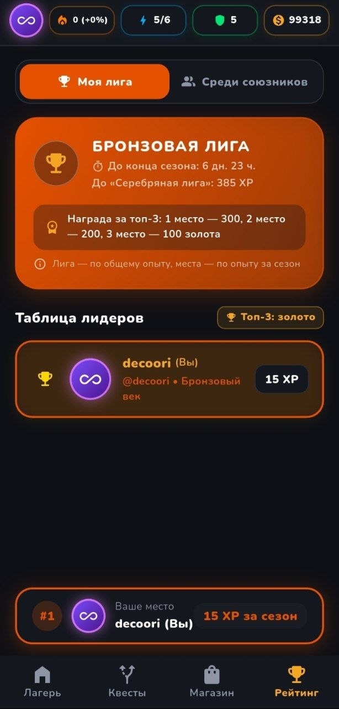
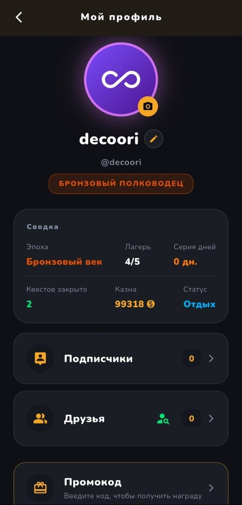

<div align="center">



# PRAXIS

**Трекер целей, который выглядит как игра: цель превращается в цепочку квестов, а прогресс — в развитие цивилизации от каменного века до космической эры.**

[](https://github.com/decoori/Praxis/actions/workflows/ci.yml)
[](https://flutter.dev)
[](https://supabase.com)
[](LICENSE)

</div>

---

## Что это

PRAXIS — приложение для тех, кто устал от списков дел, которые не хочется открывать. Вы описываете цель — «выучить испанский», «подтянуть физику», «пробежать полумарафон» — а приложение разбивает её на небольшие шаги-квесты.

За каждый закрытый шаг начисляются опыт и золото. Опыт двигает цивилизацию по эпохам, золото уходит на лагерь, энергию и новые слоты целей. Ежедневные квесты поддерживают серию, а раз в неделю игроки соревнуются в лигах.

Всё это — с тёмным интерфейсом, аватарами и ощущением, что вы развиваете не список дел, а маленькую цивилизацию.

## Как это работает

1. **Ставите цель.** Опишите её словами — ИИ предложит шаги. Или возьмите готовую из библиотеки, или соберите вручную.
2. **Проходите квесты.** Шаги открываются по порядку. За каждый — опыт, золото и, если нужно, таймер фокуса.
3. **Развиваете лагерь.** Четыре постройки на эпоху усиливают награды. Полностью отстроенный лагерь и накопленный опыт открывают следующую эпоху.
4. **Держите серию и соревнуетесь.** Каждый день с квестами продлевает серию. Раз в неделю — новая лига и награды за топ-3.

## Что внутри

- **Цели тремя способами** — генерация ИИ, готовые пресеты, ручной конструктор.
- **Квесты по порядку** — с наградами, таймерами и редактированием.
- **Энергия** — шесть квестов в день; запас растёт с эпохами и постройками.
- **Серия и щиты** — пропуск дня можно закрыть щитом, серию — восстановить за золото.
- **Лагерь и шесть эпох** — от каменного века до космической эры.
- **Магазин** — зелья энергии, щиты и слоты целей.
- **Лиги и сезоны** — место по опыту за неделю, золото за топ-3.
- **Друзья** — поиск по ID и рейтинг среди союзников.
- **Таймер фокуса** — время сессии проверяет сервер, поэтому сдать квест раньше нельзя.
- **Промокоды** — разовые награды за код.

## Скриншоты

| Лагерь | Квесты | Магазин |
|:---:|:---:|:---:|
|  |  |  |

| Рейтинг | Профиль |
|:---:|:---:|
|  |  |

> Скриншоты сняты на тестовом аккаунте с отладочными данными. Ники реальных игроков не показаны.

## Технологии

Приложение — Flutter: Material 3, тёмная тема, шрифт Nunito в комплекте. Данные и авторизация — Supabase: PostgreSQL, Auth и RLS-политики. Генерация целей вынесена в отдельный HTTP-сервис; его код в репозитории не лежит, и без него приложение работает — вручную или через пресеты.

Награды, покупки и эволюцию считает сервер, поэтому прогресс нельзя накрутить из клиента.

## Запуск

Нужны Flutter **3.47+** и свой проект Supabase.

```bash
git clone https://github.com/decoori/Praxis.git
cd Praxis
flutter pub get
copy env.example.json env.json      # Linux/macOS: cp env.example.json env.json
```

Заполните `env.json`: адрес проекта и publishable (anon) ключ Supabase. Затем примените миграции из `migrations/` по порядку в SQL Editor — подробности в [docs/database.md](docs/database.md).

```bash
flutter run --dart-define-from-file=env.json
```

Без ключей приложение не упадёт: покажет экран настройки с нужной командой. Сборка APK:

```bash
flutter build apk --release --dart-define-from-file=env.json
```

Проверки перед изменениями:

```bash
flutter analyze
flutter test
```

## Документация

| Документ | О чём |
|---|---|
| [docs/database.md](docs/database.md) | миграции, RLS, лиги, промокоды, очистка данных |
| [docs/balance.md](docs/balance.md) | экономика и кривая прогрессии |
| [docs/release-android.md](docs/release-android.md) | подпись, сборка APK/AAB, версионирование |
| [docs/backend-ai.md](docs/backend-ai.md) | внешний сервис генерации и его «сон» на Render |
| [docs/engineering-notes.md](docs/engineering-notes.md) | тесты, производительность, тексты, известные ограничения |
| [docs/icons.md](docs/icons.md) | иконки Android, iOS, Play Store и PWA |
| [docs/marketing.md](docs/marketing.md) | статья о приложении и скриншоты |

## Ограничения

- ИИ-генерация живёт на бесплатном тарифе и засыпает после простоя: первый запрос может занять время. Клиент умеет прогревать сервис, но полностью проблему решает только внешний мониторинг.
- Таблица лидеров открыта: ники, эпоха и опыт игроков видны по anon-ключу. Секретов там нет, но приватными эти данные не будут.
- Realtime не используется: данные обновляются при заходе на вкладку.
- Код сервиса генерации целей в этот репозиторий не входит.

## Участие

Issues и pull requests приветствуются. Перед PR загляните в [CONTRIBUTING.md](CONTRIBUTING.md): там требования к тестам, миграциям и стилю, а также условия для вкладов. Об уязвимостях — приватно, как описано в [SECURITY.md](SECURITY.md), а не в публичном issue.

## Лицензия

Приложение можно свободно скачивать и использовать в личных и иных некоммерческих целях. Коммерческое использование и коммерческое распространение без письменного разрешения автора запрещены. Полные условия — в [LICENSE](LICENSE), запросы разрешений — через [профиль автора](https://github.com/decoori).

Сторонние компоненты сохраняют свои лицензии: Flutter и Dart — BSD-3-Clause, Supabase и пакеты pub.dev — по лицензиям их авторов, шрифт Nunito — [SIL OFL 1.1](assets/fonts/OFL.txt).

Название, логотип и иконки PRAXIS нельзя использовать как собственный бренд.
